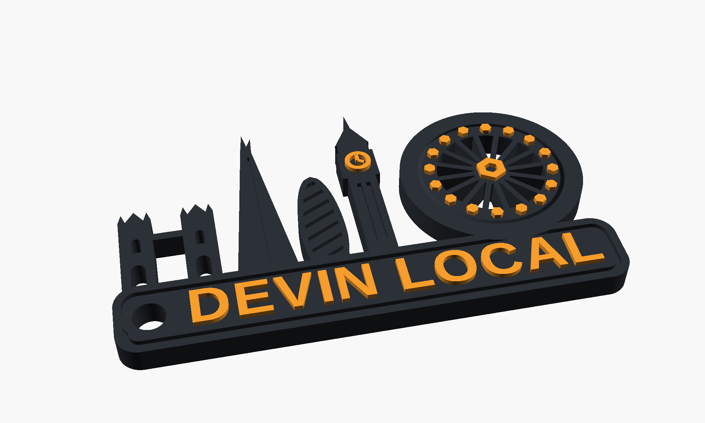
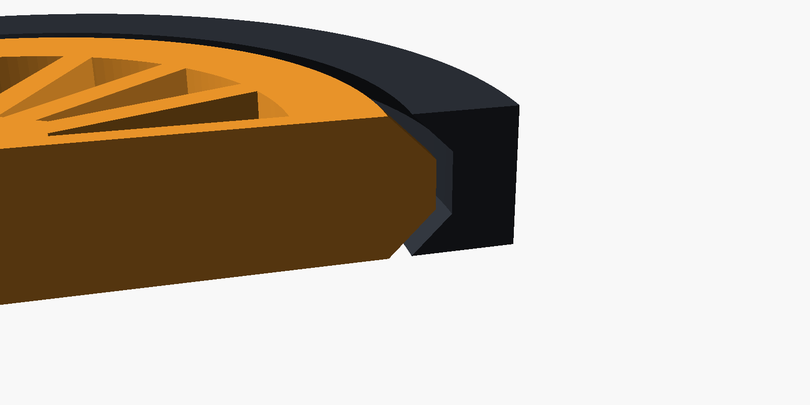

# Devin Local: London keychain

My entry for the **Keychain Challenge** at [Devin Local: London](https://luma.com/wn0h6ffm) (1 October 2026).



London's skyline from the event poster (Tower Bridge, the Shard, the Gherkin and Big Ben) sits on a "DEVIN LOCAL" nameplate. **The London Eye spins.**

- **Print-in-place spinner.** The wheel has a V-shaped bearing edge that sits in a matching groove in its frame. It comes off the print bed already captured and spinning. There's nothing to assemble, no supports and no glue.
- **Hexagon capsules.** The Eye's 16 pods are hexagons, borrowed from the Devin and Cognition logos. The hub is a hex nut.
- **Two colours from one swap.** Every raised detail (the lettering, Big Ben's clock and the Eye's pods and hub) sits above the 4 mm body. One filament change gives a two-colour print on any printer.
- **Fully parametric.** It's a single OpenSCAD file. You can change the label, the clearance or the thickness and re-export.


## Files

| File | What it is |
| --- | --- |
| [`stl/devin_local_london_keychain.stl`](stl/devin_local_london_keychain.stl) | **Print this.** Single colour, or two colours with a filament swap (see below). |
| [`stl/devin_local_london_keychain_static.stl`](stl/devin_local_london_keychain_static.stl) | The same design with the wheel fused in place, with no moving parts. |
| [`stl/two_colour/`](stl/two_colour) | `base.stl` + `accent.stl` to load as two parts for multi-material printers (AMS/MMU). Also a colour-tagged `.3mf`. |
| [`stl/eye_gap_test.stl`](stl/eye_gap_test.stl) | Just the Eye. It's a quick print for checking that the clearance suits your printer. |
| [`devin_local_london.scad`](devin_local_london.scad) | The source. |

Size: 75 × 43 × 4.8 mm, about 9 g of PLA.

## Printing

| Setting | Value |
| --- | --- |
| Material | PLA |
| Nozzle / layer | 0.4 mm / 0.2 mm |
| Walls / infill | 3 walls, 15% infill |
| Supports | **None** |
| Brim | **None.** A brim would weld the wheel to its frame. |

1. Print it flat, as exported.
2. **Two colours:** add a colour change (M600 / "pause") at the **4.2 mm layer**, which is the first layer above the body. Body in charcoal and details in orange matches the renders.
3. When it's done, hold the frame and give the wheel a firm twist to break it free. After that it spins freely.

If the wheel stays fused, increase `gap` (try 0.5–0.55) and print `eye_gap_test.stl` first. If it's very loose, decrease `gap`.

## How the spinner works



The wheel's outer edge comes to a 45° V, and the frame has the same V grooved into it, grown by `gap` (0.45 mm) normal to every face. The wheel's widest point (12.3 mm radius) is wider than the frame's narrowest lip (11.64 mm), so the wheel can't drop out of either face. Every surface overhangs at exactly 45°, so it prints without supports. On the first layer the gap opens up to 0.64 mm, which keeps elephant's foot from fusing the parts.

## Customising

Open `devin_local_london.scad` in [OpenSCAD](https://openscad.org) and use the Customizer, or override values from the command line:

```sh
openscad -D 'label="DEVIN LDN"' -D 'gap=0.5' -o my_keychain.stl devin_local_london.scad
```

| Parameter | Default | |
| --- | --- | --- |
| `label` | `"DEVIN LOCAL"` | Nameplate text |
| `spinner` | `true` | `false` fuses the wheel to the frame |
| `gap` | `0.45` | Wheel clearance in mm |
| `base_t` | `4` | Body thickness |
| `accent_t` | `0.8` | Height of the raised details |
| `part` | `"all"` | `all`, `base`, `accent`, `eye_test` or `preview` (coloured) |

To regenerate every STL and image, install OpenSCAD 2024+ (`brew install --cask openscad@snapshot`) and run `./build.sh`.
